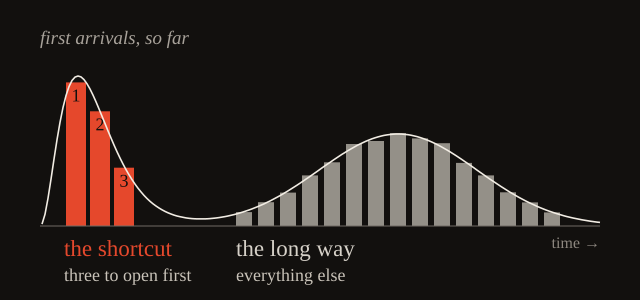

I study when a random walker first reaches its target, and why some targets have two arrival peaks: walkers that find a shortcut arrive early, and the rest take the long way. This page is laid out the same way.

PhD researcher, University of Bristol: first-passage times of random walks, and the evaluation of AI agents. 
R&D Scientist (AI), Yuexin International.

**The shortcut**

1. [Research atlas](https://zhouyi-xiaoxiao.github.io/valley-k-small/): reports and talks, in English and Chinese, on random walks with a shortcut, and on where a second arrival peak appears and when it disappears.
2. [prescribed-reaction-time-modes](https://github.com/zhouyi-xiaoxiao/prescribed-reaction-time-modes): the reproduction archive (v1.3.0) for a paper on programming the number of reaction-time peaks with a fixed budget, with its code, Lean proofs and run records.
3. [atlas-claude-tab](https://github.com/zhouyi-xiaoxiao/atlas-claude-tab): about 200 lines of Swift that make ⌘T in one AI browser open another AI, and a README on why every obvious approach failed first.

**The long way**

*Research* · [master-dissertation](https://github.com/zhouyi-xiaoxiao/master-dissertation) · [delayed-first-passage-peak](https://github.com/zhouyi-xiaoxiao/delayed-first-passage-peak) · [indoor-epidemic-random-walk](https://github.com/zhouyi-xiaoxiao/indoor-epidemic-random-walk) · [pinn-diffusion-wave-laplace](https://github.com/zhouyi-xiaoxiao/pinn-diffusion-wave-laplace)

*Tools* · [CatchMouse](https://github.com/zhouyi-xiaoxiao/CatchMouse) · [pro-agent-bridge](https://github.com/zhouyi-xiaoxiao/pro-agent-bridge) · [codex-skills-public-collection](https://github.com/zhouyi-xiaoxiao/codex-skills-public-collection)

*Prototypes* · [BioPath](https://zhouyi-xiaoxiao.github.io/biopath-platform/) · [London Cuts](https://london-cuts.vercel.app) · [SocialOS](https://github.com/zhouyi-xiaoxiao/openclaw-foundry-socialos)

*For students and colleagues* · [Tianjin maths guide](https://zhouyixiaoxiao.info/) · [Bristol law career roadmap](https://zhouyi-xiaoxiao.github.io/bristol-law-career-roadmap/) · [Bristol LLM housing map](https://zhouyi-xiaoxiao.github.io/bristol-llm-housing-map/) · [SCEM study guide](https://zhouyi-xiaoxiao.github.io/scem-study-guide/) · [SSARF agenda](https://ssarf.zhouyixiaoxiao.com/)

Everything, dated and in order: [zhouyixiaoxiao.com](https://zhouyixiaoxiao.com/) · 中文：[zhouyixiaoxiao.com/zh/](https://zhouyixiaoxiao.com/zh/)
